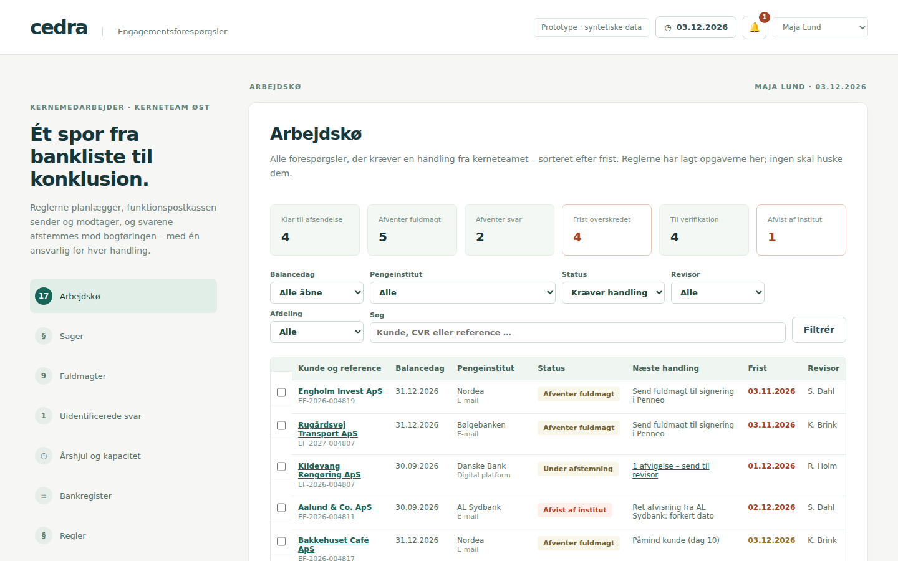
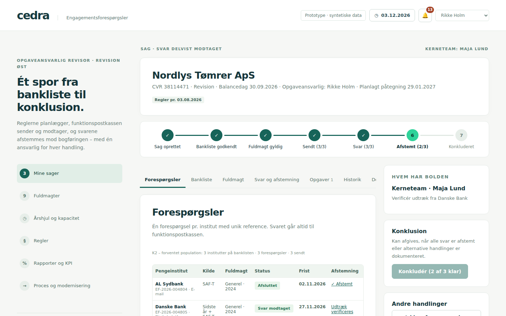
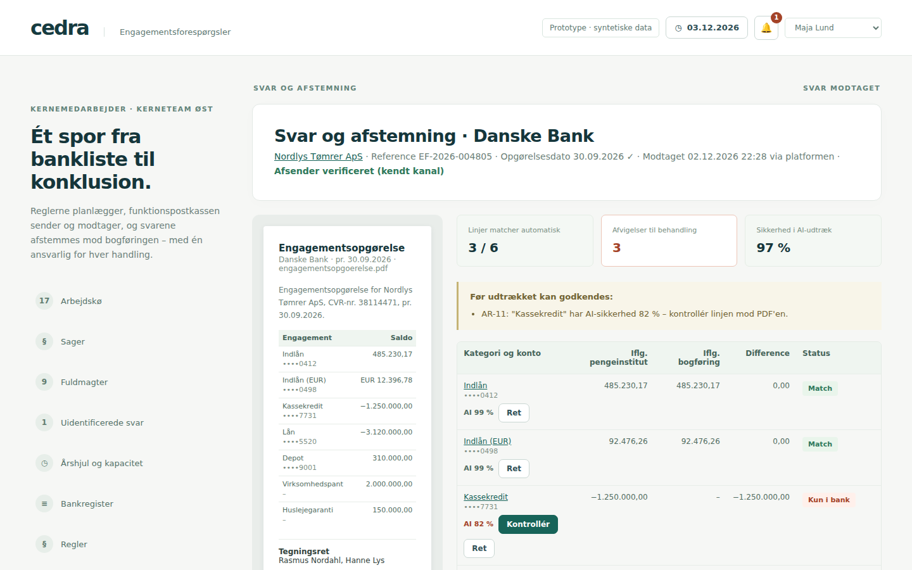
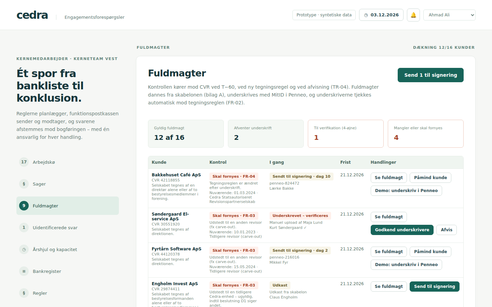
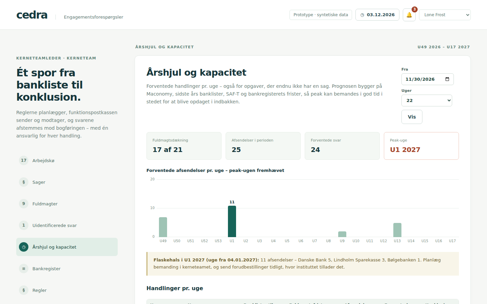

# Cedra · Engagementsforespørgsler (EF-service)

Prototype af løsningsdesignet for engagementsforespørgsler (v0.95) – bygget som én webapplikation, der erstatter
de gamle værktøjer: banklister i Excel/Access, RPA/VBA-scriptet der sender bankmails fra Outlook, svar i personlige
indbakker, fuldmagter i Word og afstemning i regneark. Se [docs/modernisering.md](docs/modernisering.md) for
kortlægningen fra gammelt værktøj til ny funktion og [docs/antagelser.md](docs/antagelser.md) for antagelser og
forenklinger.

Alle kunder, personer, CVR-numre, kontonumre og beløb er syntetiske. Pengeinstitutternes kanaler følger bilag C og skal
verificeres før brug.



## Kom i gang

```bash
cp .env.example .env
npm install
npm run setup     # opretter SQLite-databasen og afspiller sæsonen frem til demo-datoen 03.12.2026
npm run dev       # http://localhost:3000
```

Vælg bruger og rolle øverst til højre. Startsiden følger rollen (8.1): kernemedarbejderen lander i arbejdskøen,
revisoren i "Mine sager", kerneteamlederen i årshjulet og procesejeren i rapporterne.

| Bruger | Rolle | Prøv |
|---|---|---|
| Maja Lund | Kernemedarbejder (Øst) | Send Nordea-batchen i køen, verificér Danske Banks svar for Nordlys Tømrer |
| Ahmad Ali | Kernemedarbejder (Vest) | 4-øjne på Søndergaards papirfuldmagt – Maja uploadede den |
| Rikke Holm | Opgaveansvarlig revisor | Godkend Solbakkens bankliste, beslut om de kritiske afvigelser |
| Søren Dahl | Opgaveansvarlig revisor | Konkludér Nordhavn Logistik (klar til konklusion) |
| Kasper Brink | Opgaveansvarlig revisor | Beslut ved manglende svar fra Nykredit (Fjordlys) |
| Julie Bach | Revisionsmedarbejder | Forbered vurdering af afvigelser, anmod om ad hoc-forespørgsel |
| Lone Frost | Kerneteamleder | Årshjul og kapacitet, 4-øjne i bankregisteret, daglig kørsel |
| Niels Vang | Procesejer | Ny version af en regel, KPI og eksport af hændelseslog |
| Cedra-agent | AI-agent | Kan læse og foreslå (fx en bankliste-linje) – aldrig udføre |

**Demo-dato.** Systemdatoen står i headeren. "Flyt datoen" kører den daglige kørsel for hver dag imellem, så rykkere,
eskaleringer, påmindelser og nye sager opstår, som de ville i drift. Under hver forespørgsel kan pengeinstituttets svar
simuleres (normalt, uden reference, videresendt af kunden, forkert dato, afvisning eller uidentificeret).

## Skærme

| ID | Skærm | Sti |
|---|---|---|
| S01 | Arbejdskø med nøgletal, filtre, batch pr. institut og kanal, tildel/udskyd, rykkere | `/koe` |
| S02 | Mine sager med pakkesporing, næste handling og tilvalg af forespørgsler | `/sager` |
| S03/S04 | Sagsvisning: forespørgsler, bankliste, fuldmagt, svar, opgaver, historik, dokumenter, konklusion | `/sager/[id]` |
| S05 | Fuldmagter: kontrol pr. kunde med FR-ID, Penneo, påmindelser, 4-øjne, tilbagekaldelse | `/fuldmagter` |
| S06 | Svar og afstemning side om side med udtræk og bogføring | `/svar/[id]` |
| – | Uidentificerede svar (AR-01) | `/svar/uidentificerede` |
| S07 | Afvigelse: vurdering, klassifikation, begrundelse og beslutning | `/afvigelser/[id]` |
| S08 | Årshjul og kapacitet pr. uge og institut | `/aarshjul` |
| S09 | Bankregister med versionering og 4-øjne | `/bankregister` |
| S10 | Regler med versioner og ikrafttrædelse | `/regler` |
| S11 | Rapporter og KPI, eksport af hændelseslog (CSV og OCEL 2.0) | `/rapporter` |
| – | Proces og modernisering (statusmodel som diagram) | `/proces` |

| | |
|---|---|
|  |  |
|  |  |

## Arkitektur

```
src/domain/ef      Rene funktioner: kalender, regler (versioneret katalog), tidslinje, statusmodeller,
                   tegningsregel (FR-02), fuldmagtskontrol (FR-01–07), VR-kontroller, afstemning (AR-05–10),
                   rettigheder (10.3–10.5), pakkesporing, skabeloner (bilag A–B), forløbsdiagram
src/services       Use cases i transaktioner med uforanderlig hændelseslog: sager, bankliste, fuldmagter,
                   udsendelse, svar og afstemning, afvigelser, bankregister, regler, daglig kørsel, KPI
src/services/adapters  Mocks bag produktionens kontrakt: Graph (funktionspostkasse), webformular, bulkfil,
                   platform (Circit), Penneo, SharePoint, Teams – alle kald logges
src/app/api        Én tynd router med kontrakten som data (GET /api viser alle ruter)
src/app            Server-komponenter læser via de samme services; mutationer går gennem API'et
scripts/seed       Syntetisk verden + sæsonen afspillet gennem services frem til demo-datoen
```

- **Regler er data.** 47 regler (TR, VR, AR, ER, FR) med parametre og versioner. En sag evalueres med det regelsæt,
  der gjaldt ved oprettelsen (6.8).
- **Hændelsesloggen er uforanderlig** og grundlaget for historik, KPI og eksport (K6, K7).
- **Én ansvarlig og en frist** pr. opgave (K3). Sagens "næste handling" og "hvem har bolden" beregnes efter hver ændring.
- **Agenter** (`x-user-id: u-agent`) kan læse og foreslå, men aldrig udføre (10.5).

API'et kaldes med headeren `x-user-id` (prototype for Entra ID). Afsendelser og genfremsendelser kræver
`Idempotency-Key`. Fejl har formen `{ error: { code, message, reasons?, owner?, recovery? } }`.

## Test

```bash
npm test          # domæneregler (unit) + API-kontrakten mod en afspillet sæson (integration)
npm run typecheck
npm run build
```
