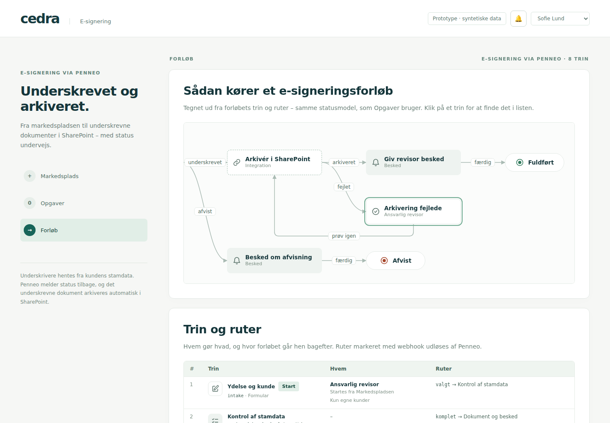

# Forløbsdiagram

Et diagram, der tegner et forløb ud fra dets trin og ruter, med en trin-tabel under. Det bruges to steder:

- **Forløb** (`/forloeb`): e-signeringsforløbet som skabelon. Klik på et trin for at finde det i listen; `?step=<nøgle>#step-<nøgle>` åbner med trinnet markeret.
- **Opgaver**: under hvert forløb vises, hvor det står nu ("Her nu"), vejen dertil (grøn) og de trin, der ikke er nået endnu (dæmpet).



## Baggrund: referencen

Udtrykket er bygget efter diagrammet i `workflows.adrianprofir.com/gallery/contract-review/` (skærmbilleder fra brugeren):

- Venstre mod højre, én kolonne pr. trin i længste vej fra start.
- Hovedsporet i øverste række, undtagelser i rækken under.
- Ruter som lige linjer og S-kurver med udfaldet i en lille pille.
- "Returneret" som afrundede løkker over eller under.
- En trin-tabel med nummer, trin (ikon, nøgle og type), hvem og ruter.

**Hvilket værktøj, referencen bruger, kunne ikke afgøres:**

- Domænet `adrianprofir.com` findes ikke i offentlig DNS, så siden kan ikke hentes udefra. Den er formentlig privat (lokalt netværk, VPN eller adgangsbeskyttet).
- Forfatterens offentlige GitHub-profil (`adrianprofir`) har intet repository til den.

**Kendetegnene peger på en egen renderer** frem for et standardbibliotek:

- Den vandrette scrollbar er en almindelig browser-scroll og ikke et pan/zoom-lærred som React Flow eller Mermaid.
- Kanterne blander kurver og retvinklede løkker.
- Undertitlen "as the builder draws it" tyder på, at tegningen kommer fra et eget forløbsbyggerværktøj.

## Beslutning: egen implementering

| Mulighed | Vurdering |
|---|---|
| **Egen layoutmotor + React (valgt)** | Ingen afhængigheder, renderes på serveren og testes som ren funktion. Rammer udtrykket præcist med browserens egen scroll og bruger Cedra-tokens. Forløbene har 8–15 trin, så en simpel lagdelt algoritme er nok |
| React Flow (@xyflow) + ELK.js/dagre | Stærkt til redigerbare grafer, men giver et pan/zoom-lærred i stedet for den scroll, referencen har. Kræver store afhængigheder (ELK alene er over 1 MB) og egne kanttyper for at ramme stilen |
| Mermaid (flowchart/state) | Hurtigt, men styling og kantføring kan kun styres begrænset, og trin kan ikke være knapper med tilstand ("Her nu") |
| Excalidraw / tldraw | Tegneværktøjer, ikke generering ud fra data |

Får I adgang til referencens kildekode, kan layoutet sammenlignes direkte.

## Sådan virker layoutet

`src/lib/workflow/layout.ts` er en ren funktion: `layoutWorkflow(definition) → { nodes, edges, width, height, start }`.

1. **Tilbagekanter:** dybde-først fra start. En rute til et trin, der stadig er åbent i gennemgangen, er en tilbagekant ("mangler", "prøv igen").
2. **Kolonner:** længste vej fra start ad de øvrige ruter.
3. **Rækker:** hovedsporet (den første rute fra hvert trin) ligger i række 0. Trin, der vender tilbage til hovedsporet (undtagelser, genforsøg), placeres først og tættest på. Den lodrette korridor under deres mål holdes fri. Andre forgreninger lægges længere nede. Et trin kan få et fast `row`-hint.
4. **Kanter:**
   - Samme række: lige linje.
   - Anden række: S-kurve i mellemrummet efter kilden, derefter vandret.
   - Står et trin i vejen, laves en omvej gennem mellemrummet mellem rækkerne.
   - Tilbagekanter: afrundede løkker over hovedsporet eller i mellemrummet under kildens række. Den første løkke, der ikke går gennem et trin, vælges.
5. **Kontrol:** `findCollisions(layout)` finder kanter gennem trin og overlappende etiketter. Testene kræver et tomt resultat for alle forløb.

Diagrammet er HTML-knapper (trin og etiketter) oven på et SVG-lag (kanter og pile). Det gør trin klikbare og tastaturbetjente og lader dem styles med samme CSS som resten af appen.

## Sådan beskriver du et forløb

```ts
import type { WorkflowDefinition } from '@/lib/workflow/types';

export const MIT_FORLOEB: WorkflowDefinition = {
  key: 'mit-forloeb',
  title: 'Mit forløb',
  start: 'intake',
  steps: [
    { key: 'intake', title: 'Oplysninger', kind: 'form', who: 'Ansvarlig revisor', badge: 'start',
      routes: [{ outcome: 'sendt', to: 'review' }] },
    { key: 'review', title: 'Gennemgang', kind: 'task', who: 'Partner', details: ['Frist 2 dage'],
      routes: [{ outcome: 'godkendt', to: 'done' }, { outcome: 'returneret', to: 'intake' }] },
  ],
  ends: [{ key: 'done', title: 'Fuldført', tone: 'ok' }],
};
```

- `kind` bestemmer ikon og flade:
  - Grå flade (automatisk): `check`, `decision`, `notify`.
  - Stiplet kant: `integration`.
  - Hvid med kant (en person): `form`, `task`, `external`.
- Den **første rute** fra et trin er hovedsporet. Skriv den "glade vej" først.
- `who` er undertitlen i diagrammet. Uden `who` vises typen.
- `details` og `note` vises kun i tabellen (frister, påmindelser, hvilken webhook der udløser ruten).

Vis det med komponenterne:

```tsx
<WorkflowDiagram workflow={MIT_FORLOEB} selected={key} onSelect={setKey} />
<WorkflowSteps workflow={MIT_FORLOEB} selected={key} onSelect={setKey} />
// Et konkret forløbs position:
<WorkflowDiagram workflow={MIT_FORLOEB} progress={{ current: 'review', path: ['intake', 'review'] }} />
```

Tilføj forløbet til `tests/unit/workflow.test.ts`, så testen fanger kanter gennem trin og overlappende etiketter.

## Test

`tests/unit/workflow.test.ts` dækker:

- **Referencediagrammet:** genskabelsen af kontraktgennemgangen (`tests/fixtures/contract-review.ts`) giver samme placering, kanttyper og løkker som referencen.
- **E-signeringsforløbet:** tegnes rent, alle trin og sluttilstande kan nås, og hver status har et trin, hvor vejen følger forløbets ruter.
- **Ugyldige definitioner:** fejler med en forståelig besked.

## Begrænsninger

- Ingen fuld krydsningsminimering. Heuristikken passer til små forløb med ét hovedspor; testen viser, når et nyt forløb tegnes uheldigt, og så kan et `row`-hint bruges.
- Løkker til trinnet selv understøttes ikke.
- Ingen zoom. Brede forløb scrolles vandret, som i referencen.
- I Opgaver udledes vejen af status, ikke af hændelsesloggen. Et forløb, der fik "arkivering fejlede" og derefter lykkedes, vises som den direkte vej.
